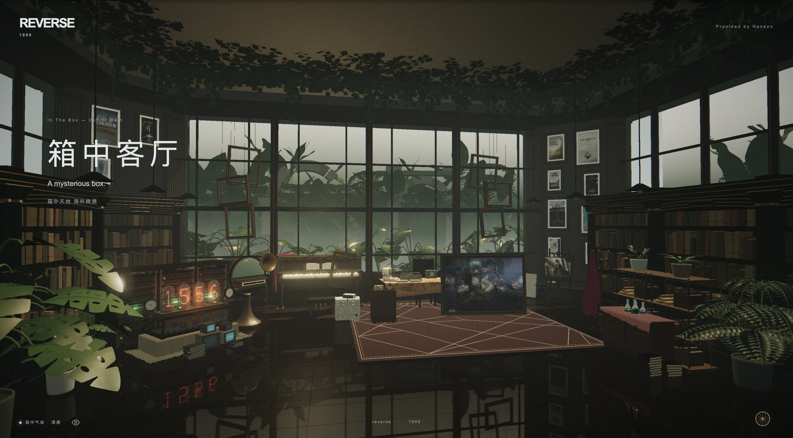
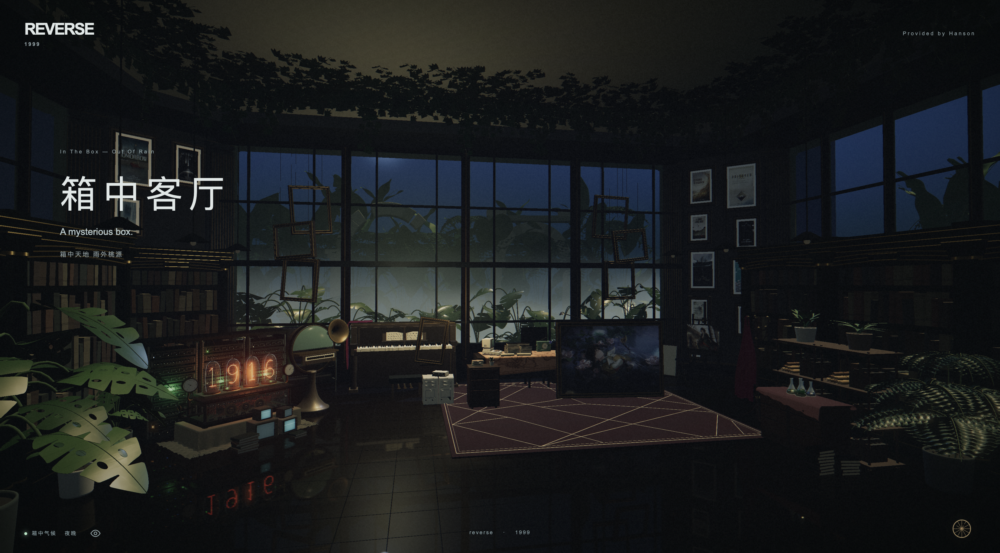
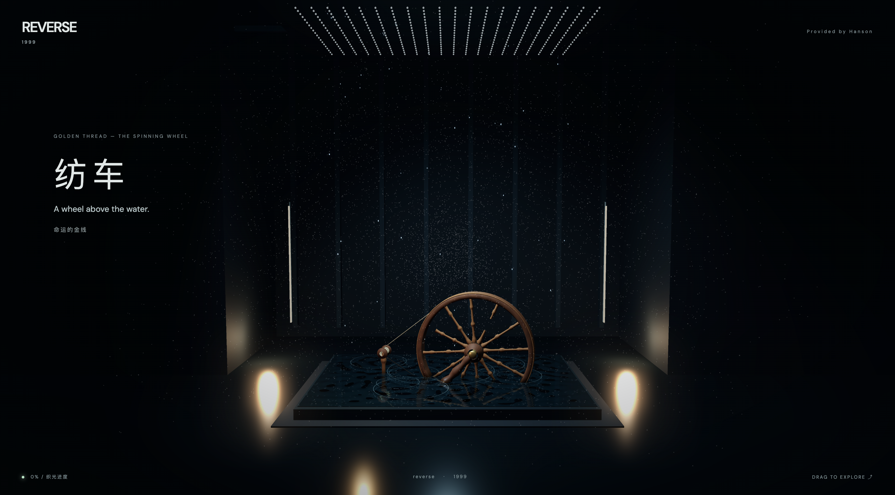
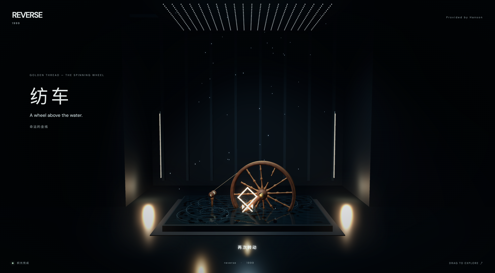

# Golden Thread · 纺车与箱中客厅

使用 Three.js 制作的《重返未来：1999》氛围交互场景，包含箱中布景和胡的印象。

支持电脑和手机浏览器，需要 WebGL2。

## 箱中客厅

还原箱中布景 - 浪潮之初

### 清晨




### 夜晚




### 操作

- 访问 `/box`，金线箱子从闭合状态缓慢打开，随后进入场景。
- 鼠标或手指拖动画面环顾；电脑滚轮调整视角宽度，W / A / S / D 或方向键小范围移动。
- 点击左下“清晨”直接切换“夜晚”，再次点击恢复清晨。两种时间下吊灯默认关闭。
- 点击眼睛图标隐藏文字，点击画面恢复。
- 点击右下纺车图标进入 `/wheel`；纺车页右下箱子图标可返回箱庭，悬停打开、移开合上。

## 纺车





- 用鼠标或手指围绕纺轮中心画弧，带动轮子转动，粒子随进度汇聚。
- 在 95% 进度前松手，轮子与粒子逐渐回退；达到阈值后自动完成演出。
- 光球绽放后，部分粒子形成水面光符；点击光符可让粒子逐渐散开。
- 点击下方发光文字“再次转动”，重新体验。

## 页面入口

| 路径 | 内容 |
| --- | --- |
| `/`、`/wheel` | 水庭纺车交互演出 |
| `/box` | 箱中客厅，清晨与夜晚切换 |
| `/test` | 场景试验台：时间、天气、吊灯开关、雾气、画面效果与镜头调试 |
| `/test/modules` | 单组件预览，支持旋转、缩放与平移 |
| `/test/modules?module=trunk` | 紫黑菱格旅行箱模型，支持箱盖与黄铜扣开合预览 |

测试页支持清晨 / 夜晚、薄雾 / 晴朗组合，并可手动开关吊灯；这些调试项与 `/box` 的简洁界面分开。

## 本地运行

```bash
npm install
npm run dev
```

使用终端显示的地址访问，例如在地址后添加 `/box` 进入箱中客厅。手机调试时，与电脑连接同一局域网，并运行：

```bash
npm run dev -- --host 0.0.0.0
```

手机访问终端显示的 Network 地址。

## 构建与预览

```bash
npm run build
npm run preview
```

构建产物位于 `dist/`。

## 检查

```bash
for test in tests/*.mjs; do node "$test" || break; done
```

技术栈：Three.js、JavaScript、GLSL、Vite。
