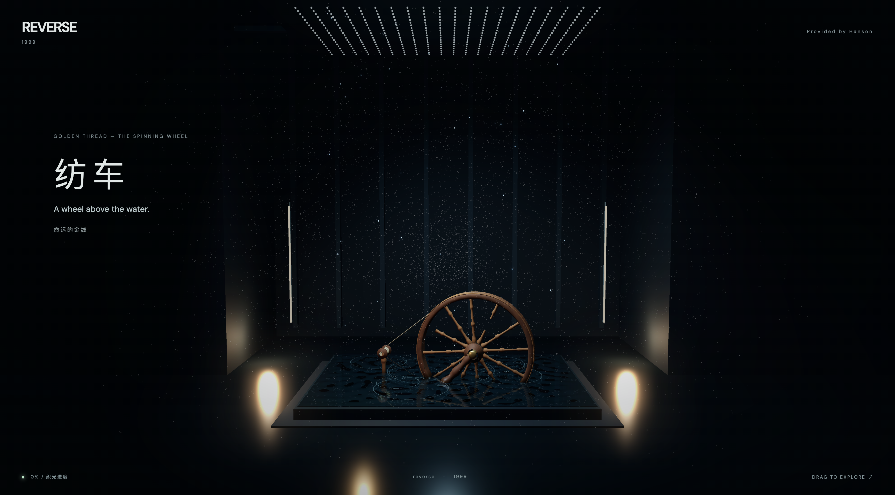
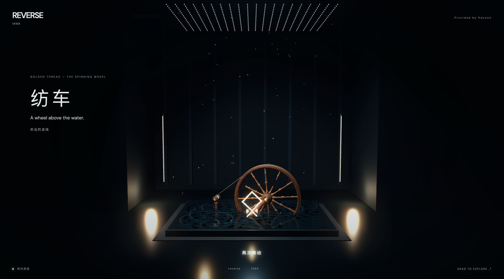

# Golden Thread · 纺车

一个使用 Three.js 制作的重返未来1999纺车交互场景

## 体验





- 用鼠标或手指围绕纺轮中心画弧，带动轮子转动，粒子随进度汇聚。
- 在 95% 进度前松手，轮子与粒子逐渐回退；达到阈值后自动完成演出。
- 光球绽放后，部分粒子形成水面光符；点击光符可让粒子逐渐散开。
- 点击下方发光文字“再次转动”，重新体验。

支持电脑和手机浏览器，需要 WebGL2。

## 本地运行

```bash
npm install
npm run dev
```

使用终端显示的地址访问。手机调试时，与电脑连接同一局域网，并运行：

```bash
npm run dev -- --host 0.0.0.0
```

手机访问终端显示的 Network 地址。

## 构建与预览

```bash
npm run build
npm run preview
```

构建产物位于 `dist/`。

## 检查

```bash
for test in tests/*.mjs; do node "$test" || break; done
```

技术栈：Three.js、JavaScript、GLSL、Vite。
